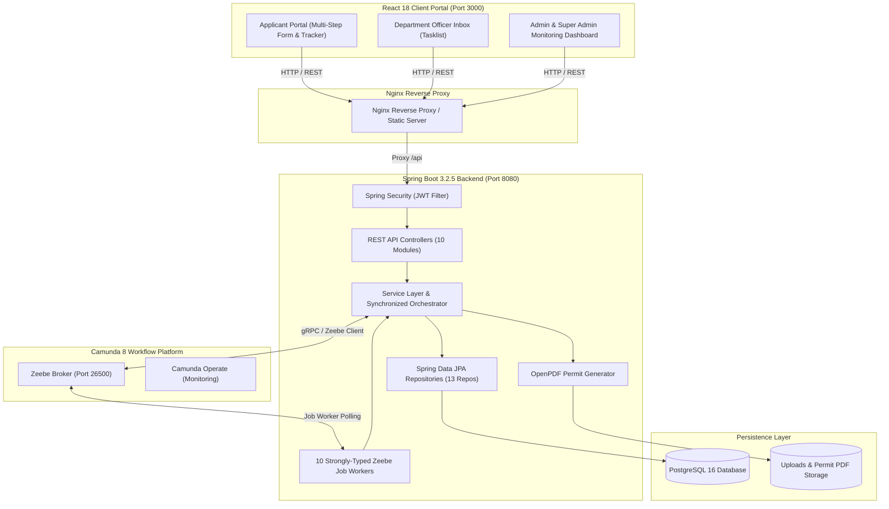
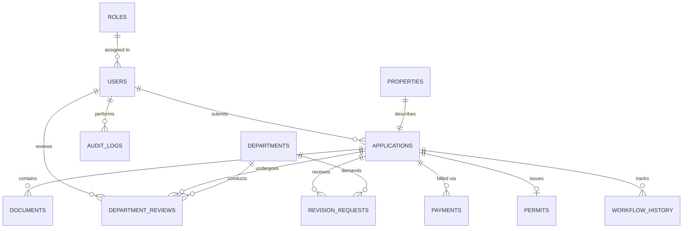

# CIVICBUILD: Municipal Multi-Department Building Permit Automation Portal

[](https://www.oracle.com/java/)
[](https://spring.io/projects/spring-boot)
[](https://camunda.com/)
[](https://react.dev/)
[](https://vitejs.dev/)
[](https://tailwindcss.com/)
[](https://www.postgresql.org/)
[]()

> **Production-Style Academic Capstone Project**  
> An enterprise-grade, event-driven workflow automation application digitizing municipal building permit approvals through **Camunda 8 (Zeebe BPMN 2.0)** orchestration, a **Spring Boot 3** REST microservice architecture, a **React 18** responsive single-page portal, and **PostgreSQL 16** relational persistence.

---

## Table of Contents
1. [Project Overview & Problem Statement](#1-project-overview--problem-statement)
2. [Technology Stack & Version Compatibility Matrix](#2-technology-stack--version-compatibility-matrix)
3. [System Architecture & Persona Workflows](#3-system-architecture--persona-workflows)
4. [BPMN 2.0 Process Architecture](#4-bpmn-20-process-architecture)
5. [Database Architecture & Entity Relationships](#5-database-architecture--entity-relationships)
6. [REST API Documentation](#6-rest-api-documentation)
7. [FEEL Expression Dictionary](#7-feel-expression-dictionary)
8. [Getting Started & Local Setup](#8-getting-started--local-setup)
9. [Docker Deployment Guide](#9-docker-deployment-guide)
10. [Automated Test Suite (18 Scenarios)](#10-automated-test-suite-18-scenarios)
11. [Pre-Seeded Demo Accounts & Credentials](#11-pre-seeded-demo-accounts--credentials)

---

## 1. Project Overview & Problem Statement

### 1.1 The Municipal Dilemma
Municipal building approvals traditionally suffer from acute operational bottlenecks:
- **Serial Silos:** Applications pass manually from desk to desk across Fire, Water, Zoning, and Environmental departments, stretching review cycles from weeks to months.
- **Lost Paperwork & Inconsistent Checks:** Blueprint drawings and structural stability certificates are repeatedly scrutinized without standardized checklists.
- **Zero Transparency:** Citizens cannot track where their file is stuck, leading to administrative corruption and excessive follow-up visits.
- **Broken Escalations:** When an officer leaves a file unattended, there are no automated timers or Service Level Agreement (SLA) alerts.

### 1.2 The CivicBuild Solution
CivicBuild completely digitizes and automates the statutory building permit lifecycle:
1. **Applicant Self-Service:** Online registration, multi-step application drafting, document uploads (PDF/CAD), live 7-stage workflow tracker, and online fee settlement.
2. **Camunda 8 Orchestration:** The business process is managed by an industrial BPMN 2.0 workflow engine (Zeebe broker) with strict data boundaries.
3. **Sequential Document Checklist:** Automated verification pipeline that sequentially inspects submitted documents and raises a BPMN Error Boundary Event (`MISSING_CRITICAL_DOCUMENT`) if critical records are absent.
4. **Parallel Multi-Instance Reviews:** All four municipal departments (Fire, Water, Zoning, Environmental) receive concurrent review tasks in their customized inboxes.
5. **Embedded Revision Loops:** Department officers can request revisions; the process encapsulates revisions inside a sub-process bounded by a statutory limit of 3 cycles.
6. **Statutory SLA Timers:** Timer Boundary Events monitor review durations and trigger automatic administrative escalations upon SLA breach.
7. **Automated Fee Calculation & Payment:** Reusable Call Activity evaluates built-up area and floor counts, generates an electronic invoice, and verifies online mock payments.
8. **Digital Permit Generation:** Issues a tamper-proof PDF building permit featuring a 2D QR verification code, municipal seal, and 3-year statutory validity.

---

## 2. Technology Stack & Version Compatibility Matrix

| Tier | Technology | Version | Purpose |
| :--- | :--- | :--- | :--- |
| **Workflow Engine** | Camunda 8 / Zeebe | `8.5.0` | BPMN 2.0 process orchestration, job workers, FEEL expressions |
| **Backend Runtime** | Java OpenJDK | `17 LTS` | Core programming language |
| **Backend Framework** | Spring Boot | `3.2.5` | Enterprise REST APIs, DI container, application configuration |
| **Security** | Spring Security + JJWT | `0.11.5` | Stateless JWT authentication, RBAC, password hashing (BCrypt) |
| **Persistence** | Spring Data JPA / Hibernate | `6.4.4` | Object-Relational Mapping (ORM) and transaction management |
| **Database** | PostgreSQL | `16.0` | Production RDBMS with ACID guarantees |
| **In-Memory DB** | H2 Database | `2.2.224` | Zero-configuration dev & test profile (`MODE=PostgreSQL`) |
| **PDF Generation** | OpenPDF (LibrePDF) | `1.3.39` | High-fidelity municipal permit certificate generation |
| **Frontend Framework**| React | `18.2.0` | Single-Page Application (SPA) UI |
| **Build Tooling** | Vite | `5.2.0` | Ultra-fast HMR and production bundle optimization |
| **Styling** | Tailwind CSS | `3.4.1` | Utility-first responsive design system |
| **Icons** | Lucide React | `0.344.0`| Clean vector icon system |
| **Data Viz** | Recharts | `2.12.2` | Interactive analytics charts for admin dashboards |
| **Containerization** | Docker & Docker Compose | `v2+` | Multi-stage image build and multi-container orchestration |

---

## 3. System Architecture & Persona Workflows



### 3.1 Four Supported User Personas
1. **Applicant (`ROLE_APPLICANT`):**
   - Registers profile, logs in via JWT.
   - Submits building permit application through a 4-step wizard.
   - Uploads statutory documents (ownership deed, blueprint, structural cert).
   - Monitors live 7-stage interactive workflow progress.
   - Responds to department revision requests by re-uploading documents.
   - Simulates UPI / Card / Net Banking payment of municipal fees.
   - Downloads digitally signed PDF permit.
2. **Department Officer (`ROLE_OFFICER`):**
   - Filtered view by department (`FIRE`, `WATER`, `ZONING`, `ENVIRONMENTAL`).
   - Inspects blueprints and property details.
   - Submits formal decisions: `APPROVED`, `REJECTED`, or `REVISION_REQUESTED`.
3. **Municipal Administrator (`ROLE_ADMIN`):**
   - System-wide application monitoring and search.
   - Department workload management.
   - SLA breach alerts and timer escalation tracking.
   - Complete audit trail and workflow transition log inspection.
4. **Super Admin (`ROLE_SUPER_ADMIN`):**
   - User account lifecycle and role management.
   - Fee rule parameter updates.
   - System configuration and workflow health diagnostics.

---

## 4. BPMN 2.0 Process Architecture

The system features **one main executable process**, **three reusable child processes (Call Activities)**, and **one embedded sub-process**:

```
bpmn-models/
├── main-process.bpmn                     (BuildingPermitApprovalProcess)
└── child-processes/
    ├── document-verification.bpmn        (DocumentVerificationProcess)
    ├── municipal-fee-calculation.bpmn    (MunicipalFeeCalculationProcess)
    └── permit-notification.bpmn          (PermitNotificationProcess)
```

### 4.1 Process Inventory & Constructs

| Process ID | Name | Constructs Used |
| :--- | :--- | :--- |
| `BuildingPermitApprovalProcess` | Main Approval Process | Start Event, Service Tasks, Parallel Multi-Instance (4 departments), Embedded Sub-Process (`BlueprintRevisionProcess`), Exclusive Gateways, Timer Boundary Event (PT48H), Call Activities, Terminate End Events |
| `DocumentVerificationProcess` | Document Verification | Sequential Multi-Instance (`verify-document`), Error Boundary Event (`MISSING_CRITICAL_DOCUMENT`), Exclusive Gateways |
| `MunicipalFeeCalculationProcess` | Municipal Fee Engine | Service Task (`calculate-municipal-fee`), FEEL formula evaluation, dynamic fee breakdown variables |
| `PermitNotificationProcess` | Notification Dispatcher | Service Task (`send-notification`), Email/SMS template routing, audit log attachment |
| `BlueprintRevisionProcess` | Revision Handling (Embedded) | User Task (`Revise Blueprint & Documents`), Gateway condition (`revisionCount < maxRevisions`), Service Task (`re-evaluate-revision`) |

---

## 5. Database Architecture & Entity Relationships

The relational schema is normalized into 13 core tables with foreign keys and performance indexes:



### Key Entities
- `users` & `roles`: Multi-role RBAC, BCrypt passwords, department assignment.
- `applications`: Master permit record with status enum and Zeebe process instance key.
- `properties`: Parcel metadata (survey number, ward, zone, plot area).
- `documents`: File path references, MIME types, file sizes, verification status.
- `department_reviews`: 4 parallel instances per application with due dates and remarks.
- `revision_requests`: Tracks revision cycles, officer remarks, applicant responses.
- `payments`: Transaction reference, amount, gateway response, payment method.
- `permits`: Official permit number, valid dates, QR code payload, PDF disk path.
- `workflow_history`: Immutable transition log for audit compliance.

---

## 6. REST API Documentation

### 6.1 Authentication Endpoints
- `POST /api/auth/register` – Register a new applicant account.
- `POST /api/auth/login` – Authenticate with username/password, returns JWT token.
- `GET /api/auth/me` – Fetch current user profile.

### 6.2 Application Endpoints
- `POST /api/applications/draft` – Create an application draft.
- `PUT /api/applications/{id}/draft` – Update an existing draft.
- `POST /api/applications/{id}/documents` – Upload multipart document.
- `POST /api/applications/{id}/submit` – Formally submit application (initiates BPMN workflow).
- `GET /api/applications/{id}` – Get application details.
- `GET /api/applications/my-applications` – List applications submitted by current applicant.
- `GET /api/applications` – List all applications (officer/admin).
- `GET /api/applications/{id}/status` – Live workflow status and department matrix.
- `GET /api/applications/{id}/history` – Chronological audit trail.

### 6.3 Department Review & Tasklist Endpoints
- `GET /api/reviews` – Get reviews assigned to logged-in officer's department.
- `GET /api/reviews/{id}` – Get review details.
- `POST /api/reviews/{id}/approve` – Submit approval decision.
- `POST /api/reviews/{id}/reject` – Submit permanent rejection decision.
- `POST /api/reviews/{id}/request-revision` – Submit revision request.

### 6.4 Revision Endpoints
- `GET /api/revisions/{id}` – Get revision request details.
- `POST /api/revisions/{id}/submit` – Submit applicant corrected documents and remarks.

### 6.5 Fee Settlement & Permit Endpoints
- `GET /api/payments/application/{id}` – Fetch fee amount and payment invoice.
- `POST /api/payments/application/{id}/initiate` – Initialize payment session.
- `POST /api/payments/application/{id}/confirm` – Verify payment with mock gateway.
- `GET /api/permits/application/{id}` – Fetch permit metadata.
- `GET /api/permits/{id}/download` – Download official permit PDF.

---

## 7. FEEL Expression Dictionary

| Context | FEEL Expression | Description |
| :--- | :--- | :--- |
| **All Departments Approved Gateway** | `allReviewStatus = "APPROVED"` or `every r in reviewResults satisfies r.decision = "APPROVED"` | Directs workflow to Municipal Fee Calculation Call Activity |
| **Any Department Rejected Gateway** | `some r in reviewResults satisfies r.decision = "REJECTED"` | Directs workflow to Rejection Handling and applicant notification |
| **Revision Under Limit** | `revisionCount < maxRevisions` (`maxRevisions = 3`) | Routes to applicant revision task in BlueprintRevisionProcess |
| **Revision Exceeded Limit** | `revisionCount >= maxRevisions` | Triggers automatic application rejection for exceeding revision cap |
| **Missing Document Business Error** | `documentExists = false and isMandatory = true` | Throws `MISSING_CRITICAL_DOCUMENT` ZeebeBpmnError |
| **Timer Boundary Duration** | `duration("PT48H")` | Triggers SLA timeout escalation if review exceeds 48 hours |

---

## 8. Getting Started & Local Setup

### Prerequisites
- Java 17 LTS (`java -version`)
- Maven 3.8+ (`mvn -version`)
- Node.js 18+ & npm (`node -v`, `npm -v`)
- PostgreSQL 16 (Optional – dev profile uses in-memory H2 with PostgreSQL compatibility)

### 8.1 Backend Setup (Local Standalone)
```bash
cd backend-springboot
mvn clean compile
mvn test
mvn spring-boot:run
```
*Backend will start on port `8080` with pre-seeded test data.*

### 8.2 Frontend Setup (Vite Dev Server)
```bash
cd frontend-react
npm install
npm run dev
```
*Frontend will start on `http://localhost:5173` with Vite HMR.*

---

## 9. Docker Deployment Guide

Launch the full-stack system (PostgreSQL 16, Camunda Zeebe 8.5 broker, Spring Boot 3 backend, React 18 SPA) in one command:

```bash
docker compose up --build -d
```

### Container Status Verification
```bash
docker compose ps
```

| Service | Port | URL |
| :--- | :--- | :--- |
| **Frontend Portal** | `3000` | http://localhost:3000 |
| **Backend REST API** | `8080` | http://localhost:8080/api |
| **Zeebe Broker Gateway** | `26500` | `localhost:26500` (gRPC) |
| **PostgreSQL Database** | `5432` | `localhost:5432` (db: `civicbuild`) |

---

## 10. Automated Test Suite (18 Scenarios)

The project includes an automated test suite with **37 test executions** covering all **18 mandatory academic scenarios**:

```bash
cd backend-springboot
mvn test
```

### Verified Test Scenarios Matrix

| Scenario | Test Method | Test Class | Status |
| :--- | :--- | :--- | :--- |
| **1. Successful application submission** | `testScenario1_SuccessfulApplicationSubmission` | `ApplicationWorkflowTest` | PASSED |
| **2. Missing mandatory documents validation** | `testScenario2_MissingMandatoryDocumentsValidation`| `ApplicationWorkflowTest` | PASSED |
| **3. Successful document verification** | `testScenario3_SuccessfulDocumentVerification` | `ApplicationWorkflowTest` | PASSED |
| **4. Document verification rejection** | `testScenario4_DocumentVerificationRejection` | `ApplicationWorkflowTest` | PASSED |
| **5. Missing critical document business error** | `testScenario5_MissingCriticalDocumentBusinessError`| `ApplicationWorkflowTest` | PASSED |
| **6. Parallel creation of four reviews** | `testScenario6_ParallelCreationOfFourDepartmentalReviews`| `DepartmentReviewWorkflowTest` | PASSED |
| **7. Department approval** | `testScenario7_DepartmentApproval` | `DepartmentReviewWorkflowTest` | PASSED |
| **8. Department rejection** | `testScenario8_DepartmentRejection` | `DepartmentReviewWorkflowTest` | PASSED |
| **9. Department revision request** | `testScenario9_DepartmentRevisionRequest` | `DepartmentReviewWorkflowTest` | PASSED |
| **10. Applicant resubmission of corrected docs** | `testScenario10_ApplicantResubmissionOfCorrectedDocuments`| `DepartmentReviewWorkflowTest` | PASSED |
| **11. Department re-review after resubmission** | `testScenario11_DepartmentReReviewAfterResubmission`| `DepartmentReviewWorkflowTest` | PASSED |
| **12. Review limit reached exception** | `testScenario12_ReviewLimitReachedException` | `DepartmentReviewWorkflowTest` | PASSED |
| **13. Escalation notification on overdue review** | `testScenario13_EscalationNotificationOnOverdueReview`| `DepartmentReviewWorkflowTest` | PASSED |
| **14. Fee calculation accuracy (4 types)** | `testScenario14_FeeCalculationAccuracyAcrossFourBuildingTypes`| `FeeCalculationAndPaymentTest` | PASSED |
| **15. Payment success flow** | `testScenario15_PaymentSuccessFlow` | `FeeCalculationAndPaymentTest` | PASSED |
| **16. Payment retry on failure** | `testScenario16_PaymentRetryOnFailure` | `FeeCalculationAndPaymentTest` | PASSED |
| **17. Permit generation & PDF creation** | `testScenario17_PermitGenerationAndPdfCreation` | `PermitGenerationAndE2ETest` | PASSED |
| **18. End-to-end permit approval simulation** | `testScenario18_EndToEndPermitApprovalSimulation` | `PermitGenerationAndE2ETest` | PASSED |

---

## 11. Pre-Seeded Demo Accounts & Credentials

The application initializes default demo users upon startup:

| Username | Password | Role | Department | Description |
| :--- | :--- | :--- | :--- | :--- |
| `applicant1` | `password123` | `ROLE_APPLICANT` | N/A | Citizen applicant with submitted permits |
| `fire_officer` | `password123` | `ROLE_OFFICER` | `FIRE` | Fire & Life Safety Department reviewer |
| `water_officer` | `password123` | `ROLE_OFFICER` | `WATER` | Water Supply & Sewerage reviewer |
| `zoning_officer` | `password123` | `ROLE_OFFICER` | `ZONING` | Town Planning & Urban Zoning reviewer |
| `env_officer` | `password123` | `ROLE_OFFICER` | `ENVIRONMENTAL`| Environmental & Pollution Control reviewer |
| `admin` | `password123` | `ROLE_ADMIN` | N/A | Municipal Administrator |
| `superadmin` | `password123` | `ROLE_SUPER_ADMIN`| N/A | Super Administrator |

*(The login screen also provides 1-click Quick Fill buttons to log in as any role instantly).*
