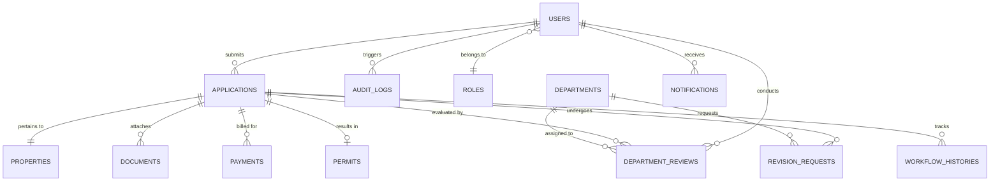

# CIVICBUILD – Entity Relationship Diagram & Database Schema

## 1. Overview of Database Architecture

The persistence model is implemented in PostgreSQL with high normalization, referential integrity constraints, indexes on lookup keys (`application_number`, `username`, `process_instance_key`), and temporal audit trails (`created_at`, `updated_at`).

---

## 2. Entity Dictionary (13 Core Entities)

### 1. `users`
Represents system actors (Applicants, Department Officers, Administrators, Super Admins).
- `id` (BIGSERIAL, PRIMARY KEY)
- `username` (VARCHAR(50), UNIQUE, NOT NULL)
- `email` (VARCHAR(100), UNIQUE, NOT NULL)
- `password` (VARCHAR(255), NOT NULL) - BCrypt hash
- `full_name` (VARCHAR(100), NOT NULL)
- `phone` (VARCHAR(20), NOT NULL)
- `role_id` (BIGINT, FK -> roles.id)
- `department_code` (VARCHAR(50), NULLABLE) - For officers (FIRE, WATER, ZONING, ENVIRONMENTAL)
- `enabled` (BOOLEAN, DEFAULT TRUE)
- `created_at` (TIMESTAMP, NOT NULL)
- `updated_at` (TIMESTAMP, NOT NULL)

### 2. `roles`
Enumerated role definitions for Spring Security RBAC.
- `id` (BIGSERIAL, PRIMARY KEY)
- `name` (VARCHAR(50), UNIQUE, NOT NULL) - `ROLE_APPLICANT`, `ROLE_OFFICER`, `ROLE_ADMIN`, `ROLE_SUPER_ADMIN`
- `description` (VARCHAR(255))

### 3. `properties`
Physical and zoning details of the construction site.
- `id` (BIGSERIAL, PRIMARY KEY)
- `address` (TEXT, NOT NULL)
- `survey_number` (VARCHAR(50), NOT NULL)
- `ward_number` (VARCHAR(20), NOT NULL)
- `zone` (VARCHAR(50), NOT NULL) - North, South, East, West, Central
- `plot_area` (NUMERIC(12,2), NOT NULL) - in sq.ft
- `ownership_type` (VARCHAR(50), NOT NULL) - FREEHOLD, LEASEHOLD, MUNICIPAL_LEASE

### 4. `applications`
Central building permit application record.
- `id` (BIGSERIAL, PRIMARY KEY)
- `application_number` (VARCHAR(50), UNIQUE, NOT NULL) - e.g. `CB-2026-1001`
- `applicant_id` (BIGINT, FK -> users.id, NOT NULL)
- `property_id` (BIGINT, FK -> properties.id, NOT NULL)
- `status` (VARCHAR(50), NOT NULL) - `DRAFT`, `SUBMITTED`, `UNDER_DOCUMENT_VERIFICATION`, `UNDER_DEPARTMENT_REVIEW`, `REVISION_REQUESTED`, `FEE_PENDING`, `PAYMENT_PENDING`, `APPROVED`, `REJECTED`
- `building_type` (VARCHAR(50), NOT NULL) - `RESIDENTIAL`, `COMMERCIAL`, `INDUSTRIAL`, `INSTITUTIONAL`
- `construction_purpose` (VARCHAR(100), NOT NULL) - NEW_CONSTRUCTION, EXTENSION, RENOVATION
- `number_of_floors` (INTEGER, NOT NULL)
- `built_up_area` (NUMERIC(12,2), NOT NULL) - in sq.ft
- `building_height` (NUMERIC(8,2), NOT NULL) - in meters
- `estimated_cost` (NUMERIC(14,2), NOT NULL)
- `parking_available` (BOOLEAN, DEFAULT TRUE)
- `process_instance_key` (VARCHAR(100), NULLABLE) - Camunda 8 Zeebe instance key
- `submission_date` (TIMESTAMP, NULLABLE)
- `approved_date` (TIMESTAMP, NULLABLE)
- `rejected_date` (TIMESTAMP, NULLABLE)
- `rejection_reason` (TEXT, NULLABLE)
- `created_at` (TIMESTAMP, NOT NULL)
- `updated_at` (TIMESTAMP, NOT NULL)

### 5. `documents`
Uploaded documentation metadata and physical disk storage path.
- `id` (BIGSERIAL, PRIMARY KEY)
- `application_id` (BIGINT, FK -> applications.id, NOT NULL)
- `document_type` (VARCHAR(50), NOT NULL) - `PROPERTY_OWNERSHIP`, `BUILDING_BLUEPRINT`, `STRUCTURAL_STABILITY`, `SITE_PLAN`, `IDENTITY_PROOF`, `OTHER`
- `file_name` (VARCHAR(255), NOT NULL)
- `file_type` (VARCHAR(100), NOT NULL)
- `file_size` (BIGINT, NOT NULL) - in bytes
- `file_path` (VARCHAR(500), NOT NULL) - Absolute storage path on server volume
- `verification_status` (VARCHAR(50), NOT NULL) - `PENDING`, `VERIFIED`, `REJECTED`
- `uploaded_at` (TIMESTAMP, NOT NULL)

### 6. `departments`
Municipal review departments.
- `id` (BIGSERIAL, PRIMARY KEY)
- `code` (VARCHAR(50), UNIQUE, NOT NULL) - `FIRE`, `WATER`, `ZONING`, `ENVIRONMENTAL`
- `name` (VARCHAR(100), NOT NULL)
- `description` (TEXT)
- `contact_email` (VARCHAR(100), NOT NULL)
- `sla_days` (INTEGER, DEFAULT 7)

### 7. `department_reviews`
Parallel review instances spawned by the BPMN workflow.
- `id` (BIGSERIAL, PRIMARY KEY)
- `application_id` (BIGINT, FK -> applications.id, NOT NULL)
- `department_code` (VARCHAR(50), NOT NULL)
- `officer_id` (BIGINT, FK -> users.id, NULLABLE)
- `status` (VARCHAR(50), NOT NULL) - `PENDING`, `IN_PROGRESS`, `APPROVED`, `REJECTED`, `REVISION_REQUESTED`
- `remarks` (TEXT)
- `due_date` (TIMESTAMP, NULLABLE)
- `reviewed_at` (TIMESTAMP, NULLABLE)
- `created_at` (TIMESTAMP, NOT NULL)
- `updated_at` (TIMESTAMP, NOT NULL)

### 8. `revision_requests`
Audit record of blueprint/document revisions requested during review.
- `id` (BIGSERIAL, PRIMARY KEY)
- `application_id` (BIGINT, FK -> applications.id, NOT NULL)
- `department_code` (VARCHAR(50), NOT NULL)
- `officer_remarks` (TEXT, NOT NULL)
- `cycle_number` (INTEGER, NOT NULL)
- `requested_at` (TIMESTAMP, NOT NULL)
- `responded_at` (TIMESTAMP, NULLABLE)
- `status` (VARCHAR(50), NOT NULL) - `REQUESTED`, `SUBMITTED`, `RESOLVED`

### 9. `payments`
Fee transactions and gateway verification records.
- `id` (BIGSERIAL, PRIMARY KEY)
- `application_id` (BIGINT, FK -> applications.id, NOT NULL)
- `amount` (NUMERIC(12,2), NOT NULL)
- `status` (VARCHAR(50), NOT NULL) - `PENDING`, `SUCCESS`, `FAILED`
- `transaction_ref` (VARCHAR(100), UNIQUE, NOT NULL)
- `payment_method` (VARCHAR(50), NOT NULL) - `CREDIT_CARD`, `DEBIT_CARD`, `NET_BANKING`, `UPI`
- `payment_date` (TIMESTAMP, NULLABLE)
- `gateway_response` (TEXT, NULLABLE)
- `created_at` (TIMESTAMP, NOT NULL)

### 10. `permits`
Final authorized municipal building permit certificates.
- `id` (BIGSERIAL, PRIMARY KEY)
- `permit_number` (VARCHAR(50), UNIQUE, NOT NULL) - e.g. `CB-PERMIT-2026-5012`
- `application_id` (BIGINT, FK -> applications.id, UNIQUE, NOT NULL)
- `issue_date` (TIMESTAMP, NOT NULL)
- `expiry_date` (TIMESTAMP, NOT NULL)
- `qr_code_data` (TEXT, NOT NULL)
- `pdf_path` (VARCHAR(500), NOT NULL)
- `issued_by` (VARCHAR(100), NOT NULL)
- `created_at` (TIMESTAMP, NOT NULL)

### 11. `workflow_histories`
Linear timeline of BPMN workflow stages and state transitions.
- `id` (BIGSERIAL, PRIMARY KEY)
- `application_id` (BIGINT, FK -> applications.id, NOT NULL)
- `stage` (VARCHAR(100), NOT NULL)
- `action` (VARCHAR(100), NOT NULL)
- `actor` (VARCHAR(100), NOT NULL)
- `timestamp` (TIMESTAMP, NOT NULL)
- `comments` (TEXT)
- `process_instance_key` (VARCHAR(100))

### 12. `notifications`
Applicant notification queue (email + in-portal alerts).
- `id` (BIGSERIAL, PRIMARY KEY)
- `recipient_email` (VARCHAR(100), NOT NULL)
- `title` (VARCHAR(200), NOT NULL)
- `message` (TEXT, NOT NULL)
- `type` (VARCHAR(50), NOT NULL) - `SUBMITTED`, `UNDER_REVIEW`, `REVISION_REQUESTED`, `REJECTED`, `FEE_GENERATED`, `PAYMENT_CONFIRMED`, `PERMIT_APPROVED`
- `sent_at` (TIMESTAMP, NOT NULL)
- `read_status` (BOOLEAN, DEFAULT FALSE)

### 13. `audit_logs`
System-wide security and governance trail.
- `id` (BIGSERIAL, PRIMARY KEY)
- `user_id` (BIGINT, NULLABLE)
- `action` (VARCHAR(100), NOT NULL)
- `entity_name` (VARCHAR(100), NOT NULL)
- `entity_id` (VARCHAR(100), NOT NULL)
- `ip_address` (VARCHAR(50))
- `timestamp` (TIMESTAMP, NOT NULL)
- `details` (TEXT)
