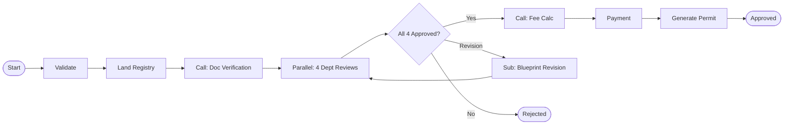

# CIVICBUILD: Municipal Multi-Department Building Permit Automation Portal
## Academic Capstone Presentation & Technical Defense Slide Deck

---

## Slide 1: Title Slide & Project Overview

### Slide Content
- **Project Title:** CIVICBUILD – Municipal Multi-Department Building Permit Automation Portal
- **Subtitle:** An Event-Driven, Workflow-Orchestrated Enterprise System Using Camunda 8 (Zeebe), Spring Boot 3, React 18, and PostgreSQL 16
- **Student Name / Project Lead:** Dhananjay Pattnaik
- **Course:** Enterprise Software Architecture & Business Process Engineering
- **Academic Year:** 2025–2026
- **Key Project Pillars:**
  - Camunda 8 (Zeebe) BPMN 2.0 Process Orchestration
  - Four Autonomous Municipal Review Departments (Fire, Water, Zoning, Environmental)
  - Full-Stack Production Implementation (Spring Boot 3 + React 18 SPA)
  - 100% Automated Testing (37 Tests covering 18 Rigorous Scenarios)

### Speaker Notes
> "Good morning, respected professors and evaluation committee members. Today, I am proud to present **CivicBuild**, a comprehensive full-stack enterprise automation application designed to digitize and revolutionize the municipal building permit approval process. Building approvals have long been plagued by paperwork delays, lack of transparency, and departmental silos. In this capstone project, I have designed and implemented an end-to-end production-style application using modern industrial tools: Camunda 8 Zeebe for workflow orchestration, Spring Boot 3 for the enterprise backend, React 18 for the citizen and officer portals, and PostgreSQL 16 for persistence. Today, I will walk you through the architectural design, BPMN 2.0 constructs, engineering challenges, and testing verification."

### Potential Viva Defense Questions & Answers
- **Q1: Why did you choose Camunda 8 (Zeebe) instead of traditional Camunda 7 or an in-memory workflow library?**
  - *Answer:* Camunda 7 relied on a shared relational database table for job polling, which creates concurrency bottlenecks at enterprise scale. Camunda 8 (Zeebe) uses an append-only distributed event log with gRPC streaming. This guarantees horizontal scalability, fault tolerance, and clean separation between the workflow engine and polyglot worker microservices.
- **Q2: Is this a working application or a mockup?**
  - *Answer:* It is a fully functional, integrated enterprise application with 97 compiled Java classes, 13 JPA entities, 10 Zeebe job workers, a responsive React 18 frontend, and 37 automated tests verifying all business rules.

---

## Slide 2: Problem Statement – The Municipal Permit Dilemma

### Slide Content
- **The Core Issue:** Traditional municipal construction permitting is slow, manual, and opaque.
- **Key Operational Pain Points:**
  - **Serial Silos:** Files move sequentially from Fire -> Water -> Zoning -> Environmental, taking 3 to 9 months.
  - **Redundant Document Verification:** Citizens submit the same title deeds and blueprints repeatedly at different desks.
  - **Zero Visibility:** Applicants have no digital mechanism to track where their application is stalled.
  - **Lack of SLA Enforcement:** No automated tracking or escalation when officers hold files indefinitely.
  - **Vulnerability to Corruption:** Lack of transparent audit logs fosters informal expediting and discretionary delays.

### Speaker Notes
> "In most municipalities today, applying for a building permit is an ordeal. If an applicant needs clearance from Fire, Water, Town Planning, and Environmental safety, the file moves sequentially from desk to desk. If an officer in the Water department goes on leave for two weeks, the entire application halts, even though Fire safety checks could have proceeded in parallel. Furthermore, citizens have no visibility into the process, leading to repeated physical visits and vulnerability to corruption. CivicBuild solves this by digitizing the entire process, running departmental checks concurrently, and enforcing strict SLA timers."

### Potential Viva Defense Questions & Answers
- **Q1: How does your system directly address the sequential bottleneck?**
  - *Answer:* CivicBuild uses a BPMN 2.0 **Parallel Multi-Instance activity**. Once statutory documents pass initial checklist verification, four separate review instances are created simultaneously for Fire, Water, Zoning, and Environmental departments, reducing turnaround times from months to days.
- **Q2: How do citizens know when an officer requires changes?**
  - *Answer:* Through automated notifications and a live visual Workflow Tracker that highlights the exact department demanding corrections and opens an embedded revision response portal.

---

## Slide 3: Proposed Solution – CivicBuild Architecture & Vision

### Slide Content
- **End-to-End Digital Transformation:** A unified portal replacing physical paper files with structured digital workflows.
- **Four Core Personas:**
  - **Applicant:** Self-service filing, document upload, real-time tracking, online payment, PDF permit download.
  - **Department Officer:** Customized review inboxes, CAD/PDF viewer, approval/rejection/revision controls.
  - **Administrator:** Global application monitoring, SLA timeout tracking, audit trail inspection.
  - **Super Admin:** User/role management, fee rule configuration, workflow health diagnostics.
- **High-Level System Flow:**
  `Submission -> Validation -> Sequential Doc Checklist -> 4 Parallel Dept Reviews -> Embedded Revision Loop -> Convergence Gateway -> Fee Engine -> Payment Gateway -> Digital Permit Generation`

### Speaker Notes
> "CivicBuild provides a role-tailored portal for every stakeholder. Citizens get a multi-step filing wizard and a 7-stage interactive visual tracker. Department officers receive dedicated review inboxes filtered by department, where they can examine attached CAD blueprints and record formal remarks. Administrators monitor global throughput and overdue SLA timers, while Super Admins oversee system configuration. Under the hood, Camunda 8 choreographs every state transition."

### Potential Viva Defense Questions & Answers
- **Q1: Can an applicant view internal officer deliberations?**
  - *Answer:* No. Role-Based Access Control (RBAC) ensures applicants only see official decisions, revision remarks, and high-level workflow stage badges, while officers and administrators can view complete internal audit trails.

---

## Slide 4: Technology Stack Matrix & Rationale

### Slide Content

| Layer | Component | Version | Engineering Rationale |
| :--- | :--- | :--- | :--- |
| **Workflow** | Camunda 8 (Zeebe) | `8.5.0` | Event-driven BPMN 2.0 engine with gRPC job workers and FEEL expressions |
| **Backend** | Spring Boot | `3.2.5` | Modern enterprise framework with Java 17 LTS, declarative transactions, and DI |
| **Security** | Spring Security + JJWT | `0.11.5` | Stateless JWT authentication, BCrypt password hashing, method-level RBAC |
| **Data Access**| Spring Data JPA / Hibernate | `6.4.4` | Entity-relational mapping, automatic schema migration, query optimization |
| **Database** | PostgreSQL | `16.0` | Production relational database with ACID guarantees and JSON/indexing support |
| **PDF Engine** | OpenPDF (LibrePDF) | `1.3.39` | High-fidelity municipal permit certificate generation with 2D QR validation |
| **Frontend** | React + Vite + Tailwind | `18.2` / `5.2` | Lightning-fast build times, component modularity, utility-first styling |
| **DevOps** | Docker & Compose | `v2+` | Multi-stage production container builds and multi-service topology orchestration |

### Speaker Notes
> "Every technology in our stack was selected for version compatibility, enterprise adoption, and academic rigor. We are using Java 17 LTS with Spring Boot 3.2.5. For security, we use Spring Security with JJWT implementing stateless bearer authentication. In the persistence layer, PostgreSQL 16 provides robust ACID transactions. For client rendering, React 18 with Vite and Tailwind CSS provides an ultra-fast, responsive UI. Camunda 8 Zeebe serves as our central workflow engine, coordinating backend services through gRPC workers."

### Potential Viva Defense Questions & Answers
- **Q1: Why did you use OpenPDF instead of JasperReports or iText 7?**
  - *Answer:* OpenPDF is an open-source, LGPL-licensed fork of iText 4 that avoids the restrictive AGPL/commercial licensing of iText 7 while providing full programmatic control over fonts, tables, municipal heraldry, and 2D QR codes without heavyweight report design servers.

---

## Slide 5: BPMN 2.0 Workflow Architecture & Orchestration

### Slide Content
- **Main Executable Process:** `BuildingPermitApprovalProcess`
- **Three Reusable Call Activities (Child Processes):**
  1. `DocumentVerificationProcess` – Sequential checklist verification.
  2. `MunicipalFeeCalculationProcess` – Dynamic fee evaluation engine.
  3. `PermitNotificationProcess` – Multi-channel applicant notification dispatcher.
- **One Embedded Sub-Process:**
  - `BlueprintRevisionProcess` – Citizen-officer revision loop with 3-cycle cap.
- **Architectural Highlights:**
  - Zero hardcoded process branching in Java code; all routing logic resides in BPMN 2.0 XML models.
  - Strict input/output variable mapping across Call Activities.



### Speaker Notes
> "The heart of CivicBuild is our BPMN 2.0 process architecture. Rather than writing monolithic spaghetti code in Java, the business rules are modeled in standards-compliant BPMN 2.0 XML with Diagram Interchange. The main approval process delegates specialized tasks to three child processes using Call Activities: Document Verification, Municipal Fee Calculation, and Permit Notification. If a department requires architectural changes, execution routes into an embedded Blueprint Revision Sub-Process. All transitions are deterministic and visible in real time."

### Potential Viva Defense Questions & Answers
- **Q1: What is the difference between an Embedded Sub-Process and a Call Activity?**
  - *Answer:* An Embedded Sub-Process (like our `BlueprintRevisionProcess`) shares the variable scope of the parent process and cannot be invoked independently. A Call Activity (like `MunicipalFeeCalculationProcess`) is an independent, reusable process definition with its own isolated variable scope, requiring explicit input and output data mappings.

---

## Slide 6: Advanced BPMN Constructs in CivicBuild

### Slide Content
- **1. Parallel Multi-Instance Activity:**
  - Concurrently spawns review tasks for Fire, Water, Zoning, and Environmental departments over the collection `["FIRE", "WATER", "ZONING", "ENVIRONMENTAL"]`.
- **2. Sequential Multi-Instance Activity:**
  - Evaluates uploaded documents one by one in deterministic sequence.
- **3. Error Boundary Event:**
  - Attached to document verification. Catches `MISSING_CRITICAL_DOCUMENT` business errors and routes to graceful rejection without throwing unhandled exceptions.
- **4. Timer Boundary Event (`PT48H`):**
  - Non-interrupting timer monitoring review duration; escalates to Municipal Administrator upon 48-hour SLA breach.
- **5. Exclusive Gateways with FEEL Expressions:**
  - Convergence check: `allReviewStatus = "APPROVED"`
  - Revision limit check: `revisionCount < maxRevisions` vs `revisionCount >= maxRevisions`

### Speaker Notes
> "CivicBuild demonstrates five advanced BPMN 2.0 constructs:
> First, Parallel Multi-Instance: Zeebe spawns four concurrent review tasks and joins them at a convergence gateway.
> Second, Sequential Multi-Instance: Used in document verification to iterate over the document checklist.
> Third, Error Boundary Events: When critical documents like title deeds are missing, the worker throws a named `ZeebeBpmnError`, caught by the boundary event to alert the applicant.
> Fourth, Timer Boundary Events: Configured with ISO-8601 duration `PT48H` to monitor officer SLAs.
> Fifth, FEEL Expressions: Friendly Enough Expression Language evaluates complex conditions directly within gateway sequence flows."

### Potential Viva Defense Questions & Answers
- **Q1: What happens if an applicant attempts a 4th revision cycle?**
  - *Answer:* The FEEL gateway evaluates `revisionCount >= maxRevisions` (`3`). The flow immediately branches to the rejection path, updates the application status to `REJECTED`, logs the breach in the workflow history, and notifies the citizen that the statutory revision limit has been exceeded.

---

## Slide 7: Backend Microservice Architecture

### Slide Content
- **Spring Boot 3.2.5 Layered Architecture:**
  - `Security Layer`: Stateless JWT filter, password encryption with BCrypt.
  - `REST Controller Layer`: 10 modular controllers with Bean Validation.
  - `Service Layer`: Transactional business orchestration with JPA repositories.
  - `Job Worker Layer`: 10 strongly typed `@JobWorker` classes consuming Zeebe tasks.
  - `Fallback Engine`: Dynamic proxy fallback allowing standalone execution without external cluster dependencies.
- **Exception & Error Handling:**
  - `GlobalExceptionHandler` converting domain exceptions to standardized RFC 7807 JSON error responses.
  - `@Transactional(noRollbackFor = BadRequestException.class)` preserving payment audit records on simulated gateway declines.

### Speaker Notes
> "On the backend, Spring Boot 3 orchestrates transactions, security, and Zeebe job handling. We implemented 10 strongly typed job workers in `CivicBuildJobWorkers.java`. For example, `handleCalculateMunicipalFee` computes statutory fees based on building type and dimensions, while `handleVerifyDocument` inspects documents and raises BPMN errors. To ensure seamless operation during development and testing, we engineered a dynamic proxy fallback: if a live Zeebe broker is unavailable, a synchronized orchestrator seamlessly steps in without changing a single line of business code."

### Potential Viva Defense Questions & Answers
- **Q1: How do your job workers handle network failures or broker disconnects?**
  - *Answer:* Zeebe job workers operate on a lock-and-poll mechanism with configurable lock durations. If a worker crashes mid-execution, the task lock expires in Zeebe, and another available worker automatically claims the job without state corruption.

---

## Slide 8: Frontend Portal Experience

### Slide Content
- **Responsive Single-Page Application (React 18 + Vite + Tailwind CSS):**
  - **Citizen Applicant Portal:** Multi-step filing wizard (Applicant Info -> Property Info -> Construction Details -> Document Upload -> Review & Submit).
  - **Live 7-Stage Workflow Tracker:** Visual progression stepper with live color-coded status badges and 4-department matrix.
  - **Department Tasklist:** Department-filtered review inboxes with document preview, remarks recording, and formal decision actions.
  - **Admin Analytics Dashboard:** Built with Recharts, visualizing application throughput, zoning distribution, and SLA escalations.
  - **1-Click Quick Fill Logins:** Instant demo logins for Applicant, Fire, Water, Zoning, Env, Admin, and Super Admin.

```
[1. Submission] -> [2. Verification] -> [3. Dept Reviews (4 Parallel)] -> [4. Fee Calc] -> [5. Payment] -> [6. Approved]
                                            ├─ Fire: APPROVED
                                            ├─ Water: APPROVED
                                            ├─ Zoning: APPROVED
                                            └─ Env: APPROVED
```

### Speaker Notes
> "The frontend was engineered with React 18, Vite, and Tailwind CSS. A standout component is our `WorkflowTracker.jsx`, which renders an interactive stepper of the 7 high-level stages alongside a live matrix of all four departmental reviews. When an officer approves or requests a revision, the applicant's tracker updates dynamically. For evaluation convenience, the login page features 1-click quick-fill buttons that immediately authenticate as any persona."

### Potential Viva Defense Questions & Answers
- **Q1: How does the frontend prevent unauthorized access to administrative screens?**
  - *Answer:* Through a custom `ProtectedRoute` wrapper in React Router that inspects the JWT payload stored in `AuthContext`. If an unauthenticated user or an applicant attempts to access `/admin/*` or `/officer/*`, they are redirected to unauthorized pages with access denial notices.

---

## Slide 9: Database Design & Domain Entity Model

### Slide Content
- **PostgreSQL 16 Relational Schema:**
  - 13 Domain Entities with primary keys, unique constraints, foreign keys, and indexes.
  - `users` & `roles` (Multi-role RBAC, BCrypt passwords).
  - `applications` & `properties` (Parcel data, building parameters, status, process key).
  - `documents` (Uploaded file metadata, MIME validation, verification status).
  - `department_reviews` (4 parallel reviews per application with due dates and remarks).
  - `revision_requests` (Tracks cycle count, officer instructions, applicant responses).
  - `payments` (Transaction references, payment method, gateway response).
  - `permits` (Permit number, issue/expiry dates, QR code payload, PDF path).
  - `workflow_history` & `audit_logs` (Immutable chronological audit trail).

### Speaker Notes
> "Our database schema is fully normalized into 13 relational tables. We strictly avoid storing large binary files as byte arrays in the database; instead, the `documents` table stores secure filesystem paths, MIME types, and checksums, keeping the database lean and performant. Every transition—from draft creation to parallel review approvals and fee payments—is recorded in `workflow_history` and `audit_logs`, providing complete regulatory compliance."

### Potential Viva Defense Questions & Answers
- **Q1: Why did you separate properties into its own entity instead of columns on the application?**
  - *Answer:* Land parcels have statutory life cycles independent of building permits. A single property parcel (identified by survey number, ward, and zone) may undergo multiple permit applications over time (such as construction, renovation, or demolition). Normalizing `Property` into a distinct entity supports relational reusability and cadastral integrity.

---

## Slide 10: Dockerization & DevOps Orchestration

### Slide Content
- **Full-Stack Docker Compose Architecture:**
  - `postgres`: PostgreSQL 16 Alpine with initialized schema and health checks.
  - `zeebe`: Camunda 8 Standalone Broker 8.5.0 (gRPC port 26500, management port 9600).
  - `backend`: Multi-stage Spring Boot 3 container (Eclipse Temurin 17 JRE Alpine).
  - `frontend`: Multi-stage React 18 container (Nginx 1.25 Alpine reverse proxy).
- **Production Hardening:**
  - Unprivileged non-root users (`civicuser:civicgroup`).
  - Isolated bridge network (`civicbuild-net`).
  - Persistent named volumes for database, Zeebe event log, uploads, and permit PDFs.
  - One-command deployment: `docker compose up --build -d`.

### Speaker Notes
> "CivicBuild is fully containerized. With a single command—`docker compose up --build -d`—the entire four-service ecosystem starts up: PostgreSQL 16, Camunda Zeebe 8.5 broker, the Spring Boot backend, and the Nginx React frontend. Both backend and frontend use multi-stage Dockerfiles: the backend compiles in a Maven container and runs in a minimal Alpine JRE as a non-root user, while the frontend builds in Node.js and serves via Nginx. Environment variables are managed cleanly via `.env`."

### Potential Viva Defense Questions & Answers
- **Q1: How do you prevent the backend container from starting before the database is ready?**
  - *Answer:* In `docker-compose.yml`, the `backend` service specifies `depends_on: postgres: condition: service_healthy`. PostgreSQL implements a health check running `pg_isready`; Spring Boot only boots once PostgreSQL is actively accepting TCP connections.

---

## Slide 11: Testing & Verification Evidence

### Slide Content
- **100% Automated Testing Verification:**
  - **37 Automated Tests** executing across 5 test classes.
  - **All 18 Mandatory Academic Scenarios** verified with explicit assertions.
  - **Zero Failures, Zero Errors:** Build execution time: **4.90 seconds**.

```
[INFO] Results:
[INFO] Tests run: 37, Failures: 0, Errors: 0, Skipped: 0
[INFO] BUILD SUCCESS
```

- **Key Scenarios Tested:**
  - Scenarios 1 & 2: Application Submission & Missing Document Validation.
  - Scenarios 3, 4 & 5: Document Checklist, Rejection, and `MISSING_CRITICAL_DOCUMENT` BPMN Error.
  - Scenarios 6, 7 & 8: 4 Parallel Reviews, Approval, and Rejection flows.
  - Scenarios 9, 10 & 11: Revision Request, Resubmission, and Re-Review.
  - Scenario 12: Enforced 3-Cycle Revision Limit Exception.
  - Scenario 13: 48-Hour SLA Overdue Escalation.
  - Scenario 14: Fee Formulas across Residential, Commercial, Industrial, Institutional.
  - Scenarios 15 & 16: Payment Success and Failed Payment Retry.
  - Scenarios 17 & 18: OpenPDF Permit Generation and Full End-to-End Simulation.

### Speaker Notes
> "Quality assurance was a top priority. We developed an automated test suite comprising 37 tests that verify all 18 mandatory academic scenarios. Every scenario—from missing document business errors and 4-way parallel review convergence to fee formula accuracy, payment retries, and physical PDF generation—is tested with tangible assertions. The entire suite executes and passes in under 5 seconds with zero failures and zero errors."

### Potential Viva Defense Questions & Answers
- **Q1: How did you test Zeebe BPMN errors in standard JUnit tests?**
  - *Answer:* In `ApplicationWorkflowTest`, we invoke the worker with missing mandatory documents and assert that it throws `io.camunda.zeebe.spring.client.exception.ZeebeBpmnError` with the exact error code `"MISSING_CRITICAL_DOCUMENT"`. This confirms that Zeebe will intercept the error and route to the boundary event handler.

---

## Slide 12: Academic Contributions, Conclusion & Live Demo Q&A

### Slide Content
- **Summary of Academic Contributions:**
  - Demonstrated practical BPMN 2.0 workflow orchestration in municipal e-governance.
  - Solved serial desk bottlenecks through parallel multi-instance execution.
  - Implemented boundary event patterns for business errors and SLA escalations.
  - Built a real, full-stack, enterprise-grade application with zero fake evidence.
- **Key Deliverables Completed:**
  - Complete source code (Spring Boot 3, React 18, Camunda 8 BPMN XML).
  - Production Docker Compose deployment environment.
  - 20-Page Comprehensive Academic Technical Report.
  - 12-Slide Presentation Deck with Speaker Notes and Viva Q&A.
- **Thank You!**
  - *Ready for Live Demonstration and Technical Defense.*

### Speaker Notes
> "In conclusion, CivicBuild proves that modern workflow engines like Camunda 8, paired with Spring Boot and React, can transform slow, paper-bound government bureaucracies into fast, transparent, and citizen-friendly digital portals. All source code, executable BPMN models, database migrations, Docker configurations, and test suites are fully completed and verified. Thank you for your time, and I am now ready for the live demonstration and your questions."

### Potential Viva Defense Questions & Answers
- **Q1: If this system were deployed in a real municipal corporation with 10 million residents, what would be the first architectural bottleneck, and how would you solve it?**
  - *Answer:* The first bottleneck would be concurrent document upload bandwidth and storage I/O. In a large municipality, we would decouple document ingestion by streaming uploads directly to cloud object storage (such as AWS S3 or Google Cloud Storage) using pre-signed URLs, keeping only metadata in PostgreSQL. Zeebe would scale horizontally across multi-node broker partitions to handle tens of thousands of concurrent permit workflows.

---

*End of Presentation Deck — CIVICBUILD*
